# Ruby 2.7.8 Tracing with Odigos

Ruby 2.7 reached end of life in 2023, but many production systems still run it. Odigos now auto-instruments **Ruby 2.7.8** applications with distributed tracing. You don't change any code, add any gems, or rebuild your app. This walkthrough uses the [ruby-278-app demo application](https://github.com/rayray221/ruby-278-app). Its `Gemfile` has **no** `opentelemetry-*` gems; Odigos injects all of the instrumentation into the running pods.

One request through the demo app produces **a single connected trace**. It spans 11 services and more than 35 Ruby libraries: web frameworks, HTTP clients, databases, caches, background jobs, message brokers and AWS. The sections below describe what Odigos captures for each kind of span.

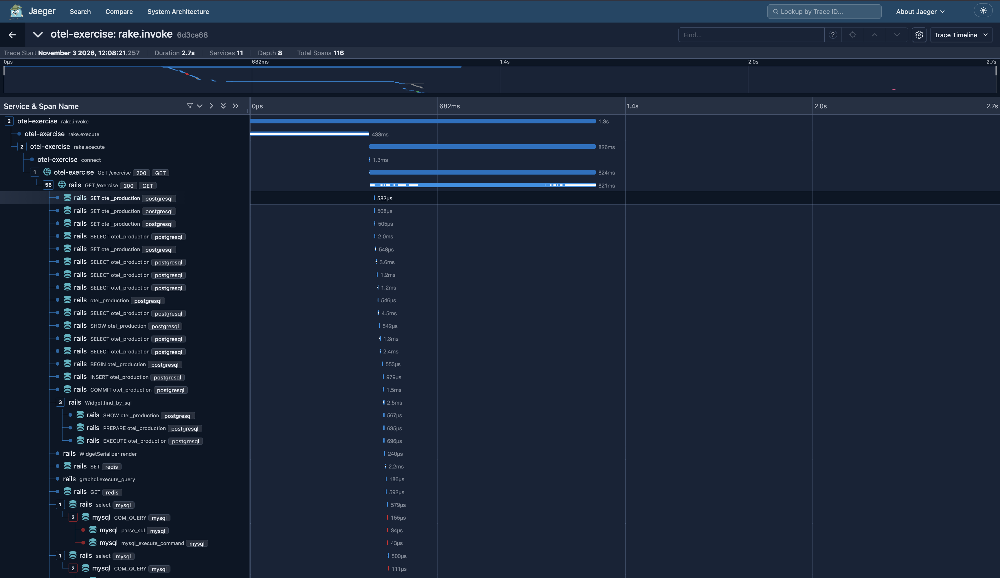

---

## At a glance

- **One trace, 11 services.** A Rake job calls Rails, and Rails fans out to Sinatra, four job workers and three message consumers. They all show up in one trace.
- **35+ libraries instrumented automatically:**
  - **HTTP:** Rack/Rails and Sinatra servers, plus 7 HTTP client libraries.
  - **Datastores:** 8 client libraries across PostgreSQL, MySQL (two drivers), MongoDB, Redis (two clients), Memcached and LMDB, plus ActiveRecord.
  - **Background jobs:** 4 frameworks.
  - **Messaging:** 4 Kafka and RabbitMQ clients.
  - **Other:** the AWS SDK, GraphQL and Rake.
- **Context propagation everywhere.** W3C trace context follows each request across HTTP calls, job queues and Kafka/RabbitMQ messages. Work done in a background worker stays in the trace of the request that triggered it.
- **Database server visibility.** Odigos also traces the MySQL server itself, and those server-side spans are linked into the same trace as the Ruby client call.
- **Kubernetes and cloud context.** Every span carries its pod, deployment, node, namespace and AWS region/zone.

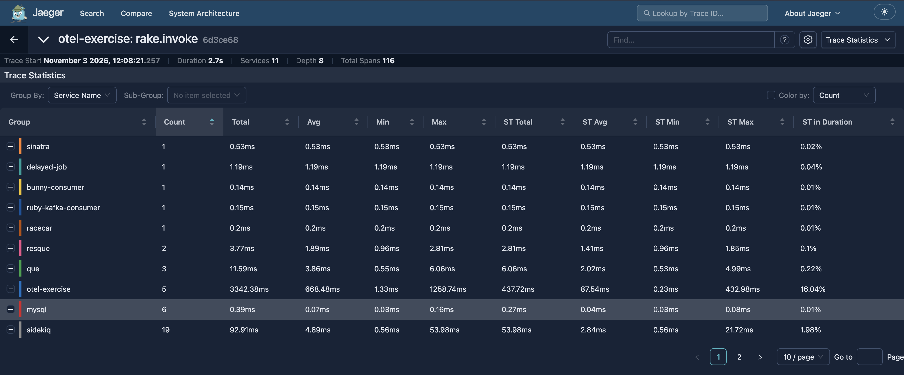

---

## The demo setup

The demo app is at **[github.com/rayray221/ruby-278-app](https://github.com/rayray221/ruby-278-app)**. It's a Rails 7.1 app on Ruby 2.7.8 plus a small Sinatra service. Everything is deployed to the `ruby-278` Kubernetes namespace.

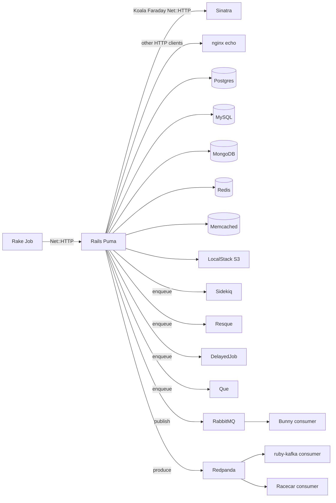

1. A Kubernetes job runs `rake otel:exercise`, which calls Rails at `GET /exercise`.
2. In that one request, Rails talks to every database, cache and HTTP client, calls S3, enqueues four kinds of background job, and publishes to RabbitMQ and Kafka.
3. Separate worker and consumer pods pick up the jobs and messages. Their spans land in the same trace.

### Enabling Ruby 2.7 instrumentation

Odigos is set to instrument the `ruby-278` namespace. An `InstrumentationRule` selects the Ruby 2.7 (`ruby-community-legacy`) distribution for Ruby workloads in that namespace:

```yaml
apiVersion: odigos.io/v1alpha1
kind: InstrumentationRule
metadata:
  name: ruby-legacy-ruby278
  namespace: odigos-system
spec:
  ruleName: "ruby 2.7 native instrumentation (ruby-278 only)"
  scopes:
    namespaces:
      - ruby-278
    languages:
      - ruby
  otelDistros:
    otelDistroNames:
      - "ruby-community-legacy"
```

This is all the setup there is: no Dockerfile changes, no Gemfile changes, no initializers.

The Sources list below shows the ten Ruby workloads, plus `mysql` (traced by Odigos' MySQL server instrumentation) and `localstack`.

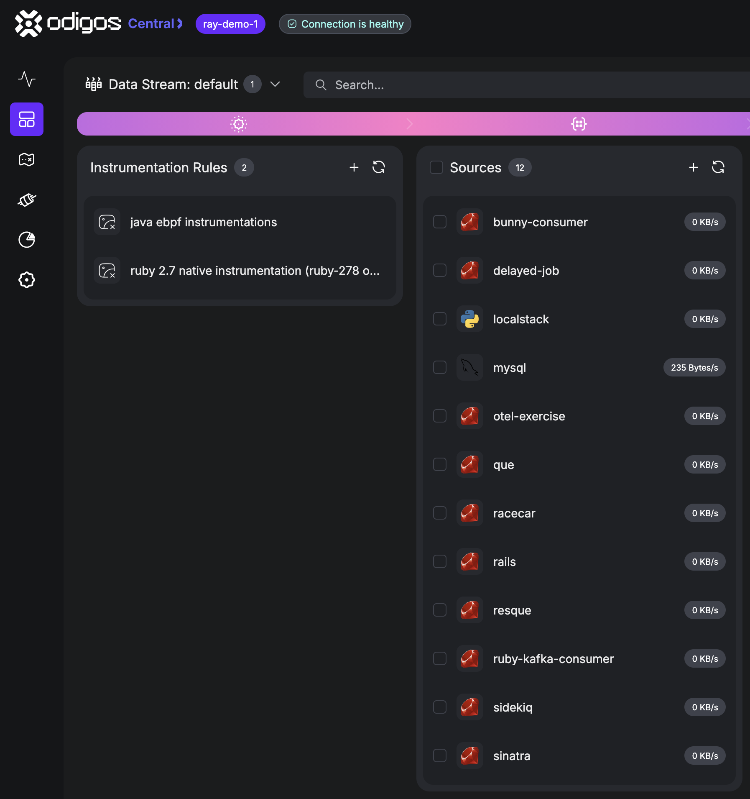

---

## Resource attributes (on every span)

Every span carries attributes that identify the service, the Kubernetes workload and the runtime that produced it.

| Attribute | Example value |
| --- | --- |
| `service.name` | `rails` |
| `k8s.namespace.name` | `ruby-278` |
| `k8s.deployment.name` / `k8s.replicaset.name` | `rails` / `rails-56d69986d9` |
| `k8s.pod.name` / `k8s.container.name` | `rails-56d69986d9-r4rv6` / `rails` |
| `k8s.node.name` | `ip-192-168-59-127.ec2.internal` |
| `odigos.workload.kind` / `odigos.workload.name` | `Deployment` / `rails` (`CronJob` / `otel-exercise` for the Rake job) |
| `cloud.provider` / `cloud.platform` | `aws` / `aws_ec2` |
| `cloud.region` / `cloud.availability_zone` | `us-east-1` / `us-east-1d` |
| `host.name` / `host.type` / `host.id` | `ip-192-168-59-127.ec2.internal` / `m6a.xlarge` / `i-013a1aa70d46ab186` |
| `process.runtime.name` / `process.runtime.version` | `ruby` / `2.7.8` |
| `process.runtime.description` | `ruby 2.7.8p225 (2023-03-30 revision 1f4d455848) [x86_64-linux]` |
| `process.command` / `process.pid` | `/usr/local/bin/bundle` / `1` |
| `telemetry.sdk.name` / `telemetry.sdk.language` / `telemetry.sdk.version` | `opentelemetry` / `ruby` / `1.2.1` |
| `odigos.version` | `v1.39.0` |

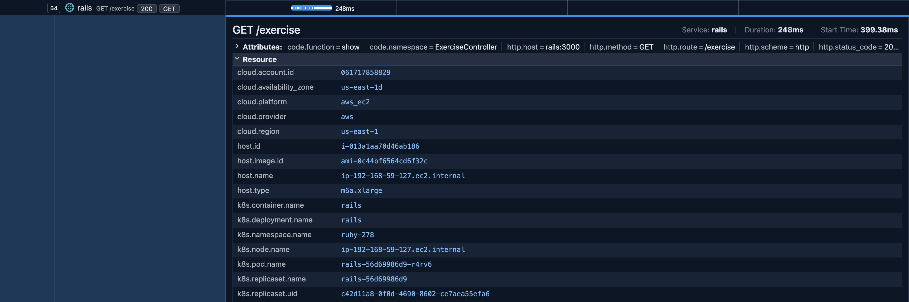

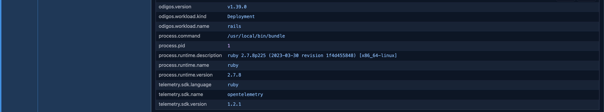

---

## What's captured, by span type

### 1. HTTP server spans

**Libraries:** Rack, Rails (ActionPack), Sinatra
**Span kind:** `SERVER`
**Span name:** `<METHOD> <path>`, e.g. `GET /exercise`, `GET /me`

Each incoming request gets a server span. If the caller sent trace context, the span continues the caller's trace. On Rails, the span also records the controller and action that handled the request.

| Attribute | Example (Rails) | Example (Sinatra) |
| --- | --- | --- |
| `http.method` | `GET` | `GET` |
| `http.route` | `/exercise` | `/me` |
| `url.path` | `/exercise` | `/me` |
| `http.target` | `/exercise` | `/me?access_token=REDACTED` |
| `http.host` | `rails:3000` | `sinatra:4567` |
| `http.scheme` | `http` | `http` |
| `http.user_agent` | `Ruby` | `Faraday v2.8.1` |
| `http.status_code` | `200` | `200` |
| `code.namespace` | `ExerciseController` | — |
| `code.function` | `show` | — |

**Why it matters:** you can see latency and status per endpoint and controller action. Each request links to the service that called it.

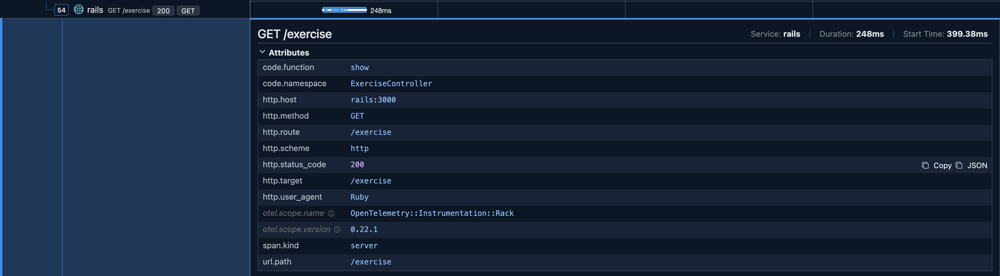

### 2. HTTP client spans

**Libraries:** Net::HTTP, Faraday, Excon, Ethon, http.rb, HTTPClient, RestClient, plus Koala (Facebook Graph API)
**Span kind:** `CLIENT`, with an `INTERNAL` connection span where the library exposes one
**Span name:** `<METHOD> <path>`, e.g. `GET /`, `PUT /otel-exercise/hello.txt`; connection spans are named `connect` or `HTTP CONNECT`

Each outbound request gets a client span and carries trace context to the server it calls. When libraries are layered, each layer gets its own nested span. For example, Koala calls Faraday, which calls Net::HTTP, which reaches Sinatra. Koala's Graph API details (`peer.service`, `koala.verb`, `koala.path`) are added to every span in that chain, so you can filter on them at any layer.

| Attribute | Example |
| --- | --- |
| `http.method` | `GET` |
| `http.url` | `http://echo/` (Faraday, Ethon, RestClient), `http://echo` (HTTPClient, http.rb) |
| `http.target` | `/otel-exercise/hello.txt` (Net::HTTP, Excon, HTTPClient, http.rb) |
| `http.scheme` | `http` |
| `http.host` | `echo` (Excon) |
| `net.peer.name` / `net.peer.port` | `localstack` / `4566` |
| `http.status_code` | `200` |
| `peer.service` | `facebook` (added by Koala) |
| `koala.verb` / `koala.path` | `get` / `me` (added by Koala) |

**Why it matters:** you can see which downstream services each request calls, how long each call takes, and what it returned. The client span sits directly above the server span on the other side.

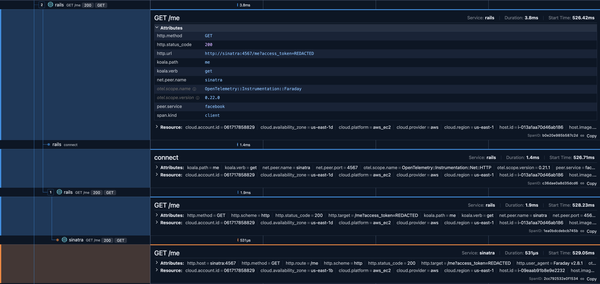

> 🔒 Odigos automatically replaces credential-style query parameters in URL attributes with `REDACTED`, as with the `access_token` above. It covers `access_token`, `appsecret_proof`, `AWSAccessKeyId`, `Signature`, `sig` and `X-Goog-Signature`. For anything else, Odigos can keep sensitive data out of your backend before it leaves the cluster, with no code changes. A **Delete Attribute** action can drop whole attributes, and a **PII Masking** action can mask values such as credit card numbers as `****`.

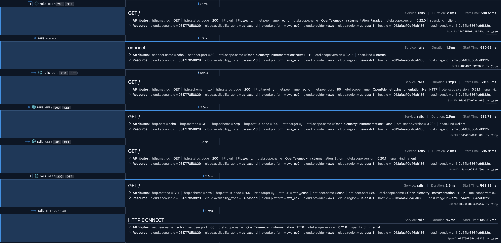

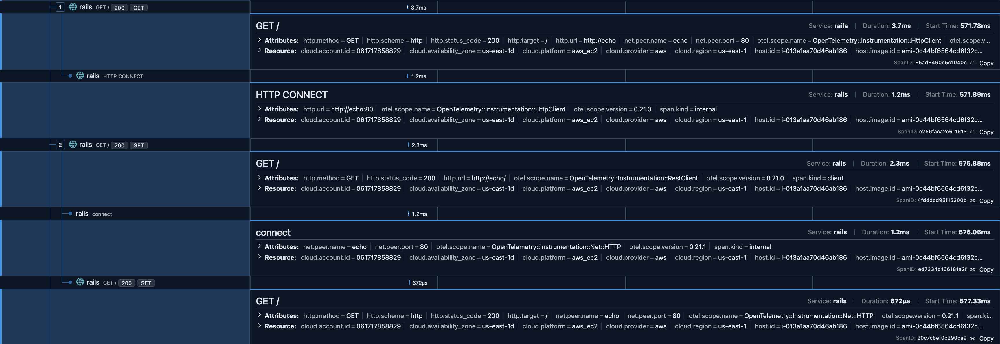

### 3. SQL database spans

**Libraries:** PostgreSQL (`pg`), MySQL (`mysql2`, `trilogy`), ActiveRecord
**Span kind:** `CLIENT` for queries; `INTERNAL` for ActiveRecord model operations
**Span name:**
- PostgreSQL: `<OPERATION> <database>`, e.g. `SELECT otel_production`, `INSERT otel_production`, `BEGIN` / `COMMIT`
- MySQL: the statement type, e.g. `select`
- ActiveRecord: `<Model>.<method>`, e.g. `Widget.find_by_sql`

Each query gets a client span showing the operation and which database it hit. Transactions show up as separate `BEGIN`, `INSERT` and `COMMIT` spans, and prepared statements as `PREPARE` and `EXECUTE`. ActiveRecord spans group the SQL a model call generates under the model method that ran it.

| Attribute | PostgreSQL example | MySQL example |
| --- | --- | --- |
| `db.system` | `postgresql` | `mysql` |
| `db.name` | `otel_production` | `otel` |
| `db.user` | `otel` | — |
| `db.operation` | `SELECT`, `INSERT`, `EXECUTE` | — |
| `db.postgresql.prepared_statement_name` | `a1` | — |
| `net.peer.name` / `net.peer.port` | `postgres` / `5432` | `mysql` / `3306` (port on `mysql2` only) |
| `net.peer.ip` | `10.100.159.225` | — |
| `net.transport` | `ip_tcp` | — |

#### MySQL server-side spans

Odigos also instruments the **MySQL server**. The Ruby MySQL client passes the current trace context to the server with each query, so MySQL's own spans appear under the Ruby `select` span:

```
select                    [rails]   CLIENT
└─ COM_QUERY              [mysql]   SERVER   mysql.command=COM_QUERY
   ├─ parse_sql           [mysql]   SERVER
   └─ mysql_execute_command [mysql] SERVER
```

The `COM_QUERY` span records the statement MySQL received in `db.statement`, which shows how the two sides are linked: the trace context travels as a SQL comment whose span ID is the Ruby `select` span.

```
SELECT 1 AS ok /*traceparent='00-6d3ce6821cbd2c686bf544d8321fb0b6-aa539c66ce986754-01'*/
```

You can see how much of a query's time went to parsing and how much to executing it inside the database, alongside the application code that issued it. This works for both `mysql2` and `trilogy`.

**Why it matters:** you can find slow or repeated queries, N+1 patterns and long transactions, and trace each one back to the request and model method that caused it.

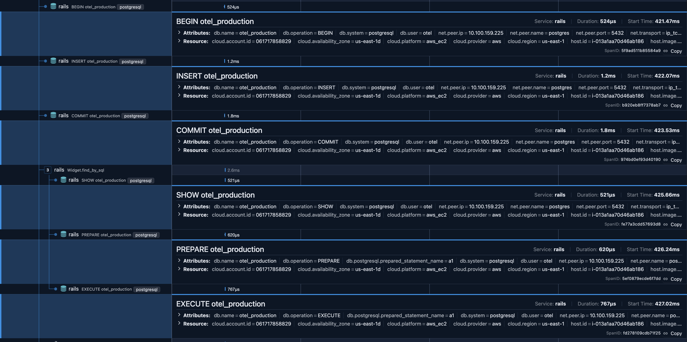

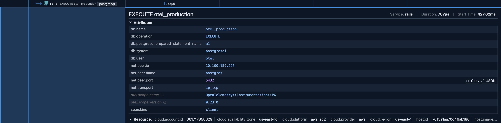

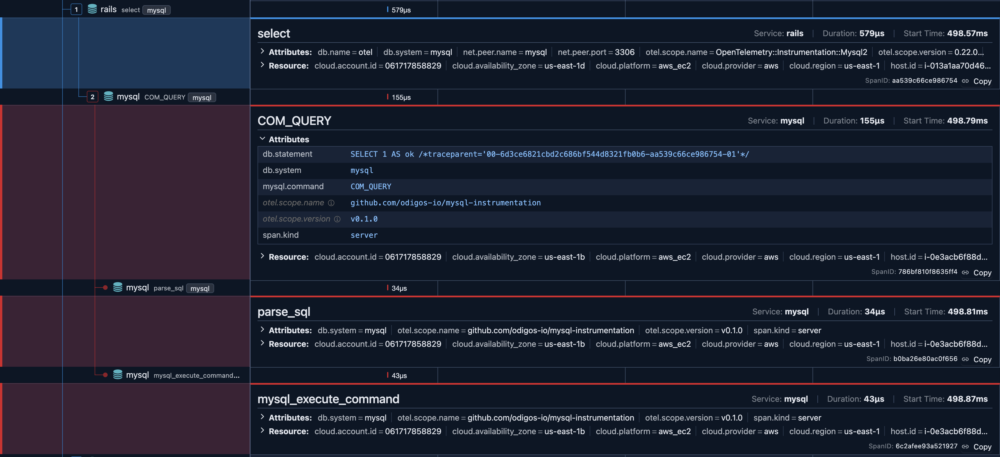

### 4. NoSQL and cache spans

**Libraries:** Redis (`redis`, `redis-client`, and the Rails cache store backed by Redis), MongoDB, Memcached (`dalli`), LMDB
**Span kind:** `CLIENT`
**Span name:**
- Redis: the command, e.g. `SET`, `GET`, `PING`, `PIPELINED`
- MongoDB: `<collection>.<command>`, e.g. `widgets.insert`, `widgets.find`
- Memcached: the operation, e.g. `get`, `set`
- LMDB: `<OP> <key>`, e.g. `PUT exercise`, `GET exercise`

| Attribute | Example |
| --- | --- |
| `db.system` | `redis`, `mongodb`, `memcached`, `lmdb` |
| `db.name` | `otel` (MongoDB) |
| `db.operation` | `insert`, `find` (MongoDB) |
| `db.mongodb.collection` | `widgets` |
| `net.peer.name` / `net.peer.port` | `redis` / `6379`, `mongo` / `27017`, `memcached` / `11211` |
| `db.redis.database_index` | when a non-default Redis DB is used |

**Why it matters:** you can see how often your app hits the cache and how long each call takes, and catch chatty Redis or Mongo usage. That includes the Redis calls your job frameworks make under the hood.

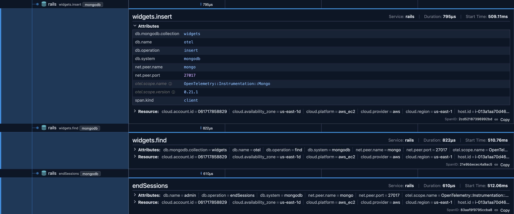

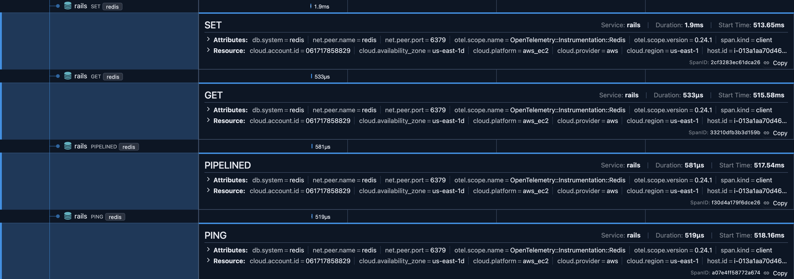

### 5. Background job spans

**Libraries:** Sidekiq (through ActiveJob), Resque, Que, Delayed Job
**Span kind:** `PRODUCER` when the job is enqueued, `CONSUMER` when it's processed
**Span name:** `<JobClass> send` / `<JobClass> process`, e.g. `ExerciseJob send` → `ExerciseJob process`

When a job is enqueued, a producer span is recorded in the web process. The enqueue itself appears under it, such as Resque's Redis `PIPELINED` push and Que's PostgreSQL `INSERT`. When a worker picks the job up, a consumer span is recorded in the worker process, **as a child of the producer, in the same trace**. Queries and cache calls the job makes are captured in that same trace. For example, the Sidekiq worker's Redis `GET` and its `Widget.find_by_sql` query appear under `ExerciseJob process`, the Resque worker's Redis `PING` appears under `ResqueExerciseJob process`, and the Que worker's PostgreSQL `DELETE` appears under `QueExerciseJob process`.

| Attribute | Sidekiq | Resque | Que | Delayed Job |
| --- | --- | --- | --- | --- |
| `messaging.system` | `sidekiq` | `resque` | `que` | `delayed_job` |
| `messaging.destination` | `default` | `exercise` | `default` | `default` |
| `messaging.destination_kind` | `queue` | `queue` | `queue` | `queue` |
| `messaging.operation` | `process` | — | `send` / `process` | `send` / `process` |
| `messaging.message_id` | `7689458c68b0685d98e29a54` | — | `6` | `6` |
| Job class | `messaging.sidekiq.job_class=ExerciseJob` | `messaging.resque.job_class=ResqueExerciseJob` | `messaging.que.job_class=QueExerciseJob` | `messaging.delayed_job.name=DelayedJobExerciseJob#perform` (send) / `DelayedJobExerciseJob` (process) |
| Extra | `messaging.active_job.executions=1` | — | `messaging.que.priority=100`, `messaging.que.attempts=0` | `messaging.delayed_job.priority=0` |

Sidekiq spans also include **span events** with the job's `created_at` and `enqueued_at` timestamps, so you can see how long a job waited in the queue.

**Why it matters:** async work stops being a blind spot. You can follow a user request into the background jobs it triggered, see how long each job waited in the queue, and see what each job did.

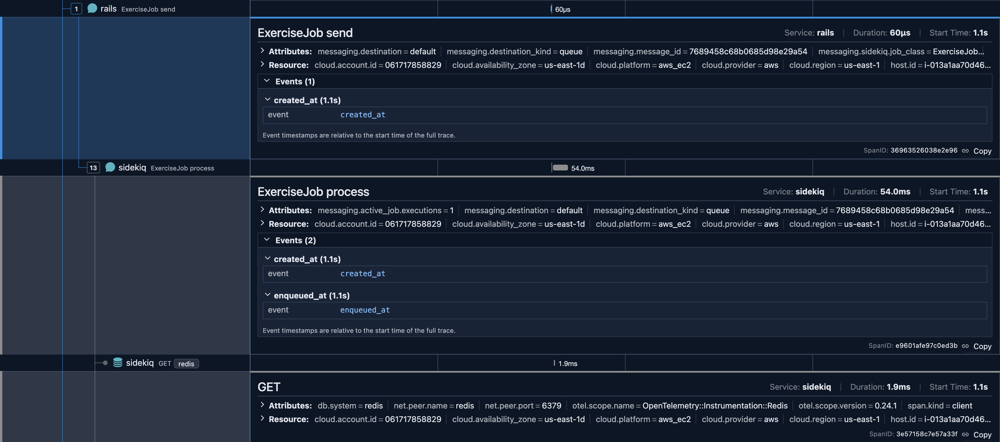

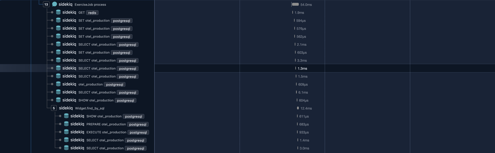

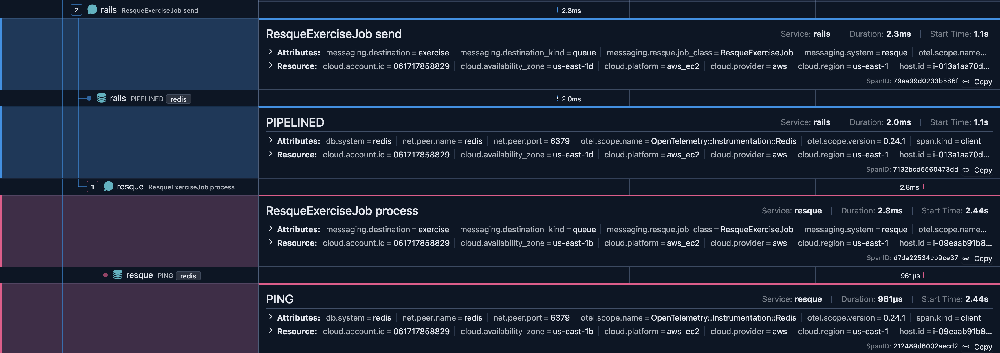

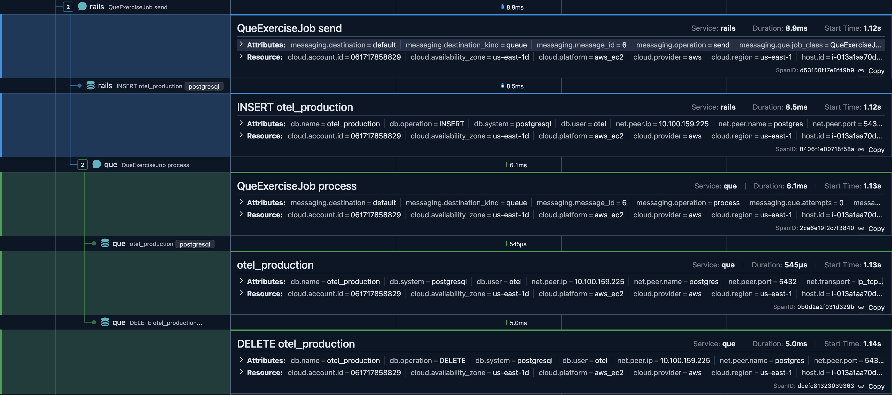

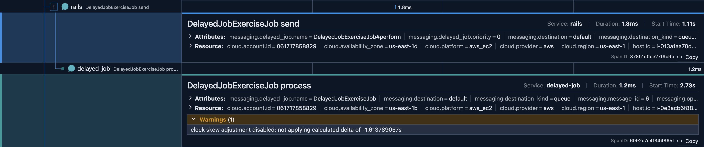

### 6. Messaging spans

**Libraries:** Bunny (RabbitMQ), ruby-kafka, rdkafka (producer), Racecar (consumer)
**Span kind:** `PRODUCER` / `CONSUMER`
**Span name:** `<destination> send` / `<destination> process`, e.g. `otel.exercise send`, `ruby-kafka-events process`, `rdkafka-events process`

Publishing a message records a producer span and injects trace context into the message headers. Consumers in other pods continue the same trace when they process the message. Consumer spans carry the same messaging attributes as the producer, so you can filter on either side.

| Attribute | RabbitMQ (Bunny) | Kafka (ruby-kafka / rdkafka / Racecar) |
| --- | --- | --- |
| `messaging.system` | `rabbitmq` | `kafka` |
| `messaging.destination` | — (default exchange) | `ruby-kafka-events`, `rdkafka-events` |
| `messaging.destination_kind` | `queue` | `topic` |
| `messaging.rabbitmq.routing_key` | `otel.exercise` (the queue name) | — |
| `messaging.protocol` / `messaging.protocol_version` | `AMQP` / `0.9.1` | — |
| `net.peer.name` / `net.peer.port` | `rabbitmq` / `5672` | — |
| `messaging.operation` | `process` (consumer) | — |
| `messaging.kafka.partition` | — | `0` (consumer) |
| `messaging.kafka.offset` | — | `5` (Racecar consumer) |
| `messaging.kafka.message_key` | — | when the message has a key |

**Why it matters:** you can follow an event from the request that published it to every consumer that handled it, across brokers and pods.

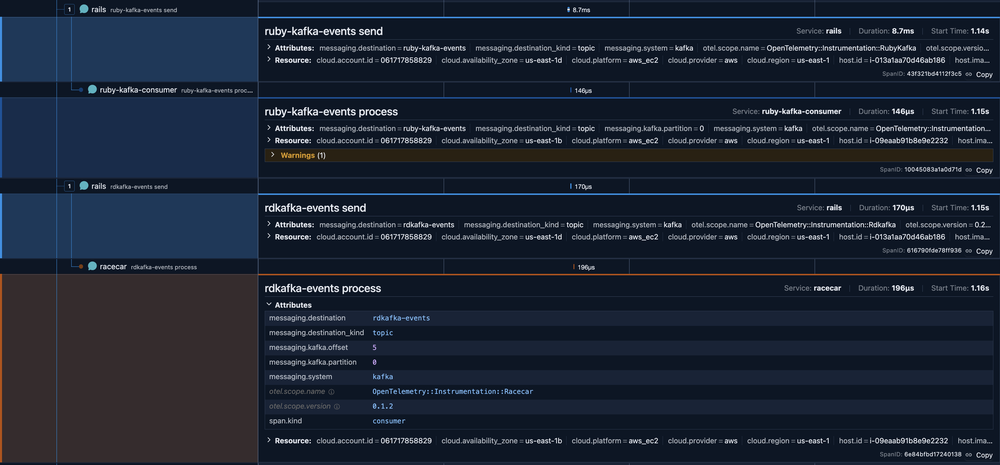

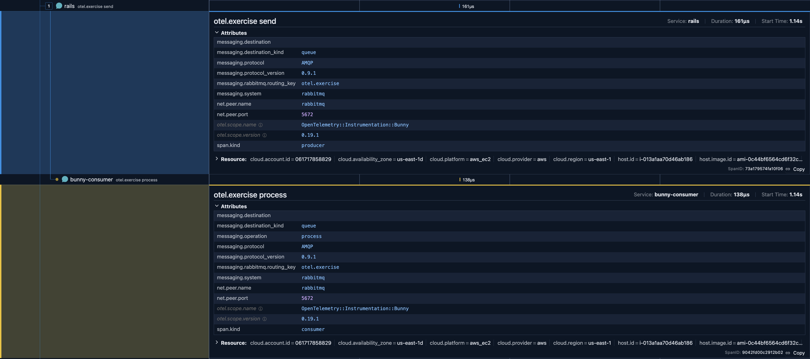

### 7. AWS SDK spans

**Library:** `aws-sdk-s3` (the demo uses LocalStack)
**Span kind:** `CLIENT`
**Span name:** `<Service>.<Operation>`, e.g. `S3.CreateBucket`, `S3.PutObject`, `S3.GetObject`

Each AWS API call gets a span named for the service and operation. The underlying HTTP request is nested underneath it.

| Attribute | Example |
| --- | --- |
| `rpc.system` | `aws-api` |
| `rpc.service` | `S3` |
| `rpc.method` | `PutObject` |
| `aws.region` | `us-east-1` |
| `http.status_code` | `200` |

**Why it matters:** you can see each AWS call by service and operation instead of a generic HTTP request.

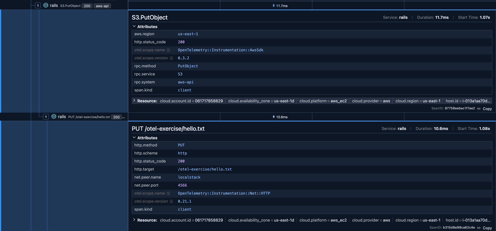

### 8. Application framework spans

**Libraries:** GraphQL, ActionView, ActiveModelSerializers
**Span kind:** `INTERNAL`

| Span | Example name | Attributes |
| --- | --- | --- |
| GraphQL query | `graphql.execute_query` | `graphql.operation.type=query`, `graphql.document={ health }` |
| View rendering | `action_view render_template` | `identifier=text template` |
| Serialization | `WidgetSerializer render` | `serializer.name=WidgetSerializer`, `serializer.renderer=active_model_serializers`, `serializer.format=ActiveModelSerializers::Adapter::Attributes` |

**Why it matters:** you can see time spent inside your own app, such as rendering, serializing and resolving GraphQL. You don't have to guess which part of the request was slow.

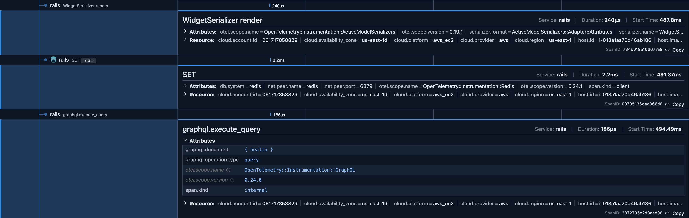

### 9. Rake task spans

**Library:** Rake
**Span kind:** `INTERNAL`
**Span name:** `rake.invoke` (the top-level task) and `rake.execute` (each task that ran, including prerequisites)

| Attribute | Example |
| --- | --- |
| `rake.task` | `otel:exercise`, `environment` |

In this demo, `rake.invoke` is the **root span of the whole trace**. The Rails `environment` load and the exercise task appear as separate `rake.execute` spans, so you can see how much of the task's time went to booting Rails.

**Why it matters:** cron jobs and one-off scripts get traced like web requests, from the task that started them down to every downstream call.

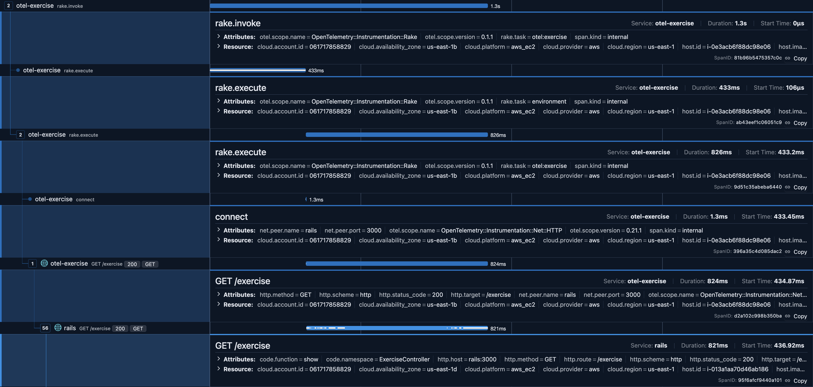

### 10. Context propagation across threads

**Library:** concurrent-ruby

concurrent-ruby doesn't create spans of its own. Work submitted to a thread pool, such as `Concurrent::Promises.future_on`, keeps the trace context of the code that submitted it, so spans created on the background thread stay in the same trace.

---

## Errors and status

- An unhandled exception in an instrumented operation is recorded as an `exception` span event with `exception.type`, `exception.message` and `exception.stacktrace`, and the span's status is set to **Error**.
- HTTP server spans are marked as errors for 5xx responses. HTTP client spans are marked as errors for 4xx and 5xx responses.
- Database, job and messaging failures, such as a MongoDB command failure or a Que job error, are recorded on the relevant span in the same way.

---

## Supported versions in this demo

**Runtime:** Ruby 2.7.8 (`ruby 2.7.8p225`), OpenTelemetry Ruby SDK 1.2.1

| Library | App gem version | Odigos instrumentation version |
| --- | --- | --- |
| Rack | 2.2.24 | 0.22.1 |
| Rails (ActionPack / ActionView / ActiveRecord) | 7.1.5.1 | ActionView 0.4.0 / ActiveRecord 0.5.0 |
| Sinatra | 3.2.0 | (uses Rack instrumentation) |
| pg | 1.5.9 | 0.23.0 |
| mysql2 | 0.5.7 | 0.22.0 |
| trilogy | 2.8.1 | 0.52.0 |
| mongo | 2.26.0 | 0.21.1 |
| redis / redis-client | 4.8.1 / 0.22.2 | 0.24.1 |
| dalli | 3.2.8 | 0.22.2 |
| lmdb | 0.6.7 | 0.21.1 |
| net/http | stdlib | 0.21.1 |
| faraday | 2.8.1 | 0.22.0 |
| excon | 0.109.0 | 0.20.1 |
| ethon | 0.16.0 | 0.20.1 |
| http | 5.1.1 | 0.21.0 |
| httpclient | 2.8.3 | 0.21.0 |
| rest-client | 2.1.0 | 0.21.0 |
| koala | 3.5.0 | (adds attributes to HTTP client spans) |
| sidekiq | 7.2.4 | 0.22.1 |
| resque | 2.6.0 | 0.3.1 |
| que | 2.3.0 | 0.5.1 |
| delayed_job | 4.2.0 | 0.19.1 |
| bunny | 2.22.0 | 0.19.1 |
| ruby-kafka | 1.5.0 | 0.19.1 |
| rdkafka | 0.13.1 | 0.2.3 |
| racecar | 2.10.0 | 0.1.2 |
| aws-sdk-s3 | 1.232.1 | 0.3.2 |
| graphql | 2.0.31 | 0.24.0 |
| active_model_serializers | 0.10.16 | 0.19.1 |
| rake | 13.4.2 | 0.1.1 |
| concurrent-ruby | 1.2.3 | (context propagation only) |