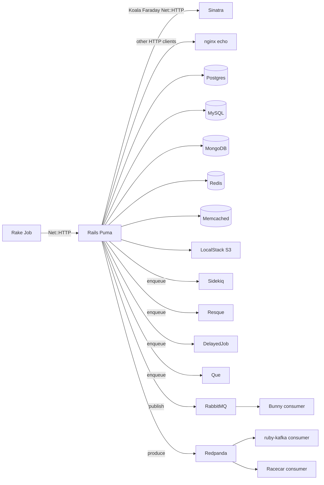

# Ruby 2.7.8 multi-library coverage app

A Kubernetes demo app that exercises the OpenTelemetry-supported Ruby libraries on **Ruby 2.7.8**. It does **not** bundle any `opentelemetry-*` gems. Instrument it at runtime with Odigos (or another auto-instrumentation agent).

The goal is maximum library coverage with as few root traces as possible. One Rake Job fans out across **10 processes**. With child-style context propagation those should appear as **one connected trace**, not 10 roots.

## What it covers

| Area | Libraries |
| --- | --- |
| Web servers | `rails`, `rack`, `actionpack`, `actionview`, `sinatra` |
| Rails extras | `activerecord`, `activejob`, `activesupport`, `active_model_serializers`, `graphql` |
| Datastores | `pg`, `mysql2`, `trilogy`, `mongo`, `redis`, `redis-client`, `dalli`, `lmdb` |
| HTTP clients | `faraday`, `excon`, `ethon`, `http`, `httpclient`, `rest-client`, `net/http`, `koala` |
| Jobs | `sidekiq`, `resque`, `delayed_job`, `que` |
| Messaging | `bunny`, `ruby-kafka`, `rdkafka`, `racecar` |
| Other | `aws-sdk-s3`, `concurrent-ruby`, `rake` |

Stack: Ruby 2.7.8, Rails 7.1.5.1, Puma, Sinatra 3.2. One Docker image, many process commands.

## How a run works



1. A Kubernetes Job runs `bundle exec rake otel:exercise`.
2. That task uses `Net::HTTP` to call Rails `GET /exercise`.
3. Rails does all client-side work in that one request: databases, caches, HTTP clients, AWS, job enqueue, Kafka/RabbitMQ produce.
4. Koala (via Faraday / Net::HTTP) hits Sinatra, which mocks the Facebook Graph API.
5. The other HTTP clients hit an uninstrumented nginx echo service so they do not create extra Ruby server traces.
6. Dedicated worker pods process the jobs and consume the messages.

## Transactions

One Rake Job should produce **one trace** whose root is T1. `curl` to Rails `/exercise` skips Rake, so that trace’s root is T2. T3–T10 are server/consumer **spans in other processes**, linked as children of T2 when the agent injects/extracts W3C context (`propagation_style: :child`). They are separate traces only if the agent does not continue the parent.

| ID | Span | Process | Libraries |
| --- | --- | --- | --- |
| T1 | Rake `otel:exercise` | exercise Job | `rake`, `net/http` (client) |
| T2 | Rails `GET /exercise` | `rails` | Rails/Rack stack, GraphQL, AMS, all datastore/HTTP/AWS clients, job and messaging **produce/enqueue** |
| T3 | Sinatra inbound | `sinatra` | `sinatra`, `rack` |
| T4 | Sidekiq perform | `sidekiq` | `sidekiq` (server), `activejob` (perform) |
| T5 | Resque perform | `resque` | `resque` (server) |
| T6 | Delayed Job perform | `delayed-job` | `delayed_job` (server) |
| T7 | Que perform | `que` | `que` (server) |
| T8 | Bunny consume | `bunny-consumer` | `bunny` (consumer) |
| T9 | ruby-kafka consume | `ruby-kafka-consumer` | `ruby-kafka` (consumer) |
| T10 | Racecar consume | `racecar` | `racecar`, `rdkafka` (consumer) |

T2 is the orchestrator. Client libraries share that request. T3–T10 exist because a real server/consumer span and cross-process propagation are required; they should still sit under T2 in the same trace.

## Prerequisites

- Docker or Podman
- `kubectl` pointed at the target cluster
- Enough node memory for the infra pods (Postgres, MySQL, MongoDB, Redis, Memcached, RabbitMQ, Redpanda, LocalStack, nginx)

The Makefile uses `docker` if it is on `PATH`, otherwise `podman`.

If you are using this with Odigos, instrument the `ruby-278` namespace (or the app Deployments) **before** or **after** apply — do not add OpenTelemetry gems to the app.

## Build

Build the application image for the host architecture (`ruby-278-app:latest` by default):

```bash
make build
```

For an **amd64** Kubernetes cluster (typical cloud nodes), set `PLATFORM` so the image is not arm64. An arm64 image on amd64 nodes fails with `exec ./docker-entrypoint.sh: exec format error`. On Apple Silicon this uses emulation and is slow the first time.

```bash
make build PLATFORM=linux/amd64
```

That is equivalent to:

```bash
docker build --platform linux/amd64 -t ruby-278-app:latest .
```

Other overrides:

```bash
make build IMAGE=ruby-278-app:dev
make build PLATFORM=linux/arm64
```

This step does not talk to Kubernetes. After a successful build, choose a deploy option below.

## Deploy

Pick **Option A** (kind + local image) or **Option B** ([ttl.sh](https://ttl.sh), any cluster that can pull public images).

### Option A: kind, image loaded into the cluster

Use this when the cluster cannot pull from the internet (or you do not want to publish the image). `imagePullPolicy` stays `IfNotPresent`.

```bash
kind create cluster --name kind   # if you do not already have a cluster
make load                         # build + kind load docker-image
make apply                        # apply manifests with ruby-278-app:latest
```

`make load` builds first, then loads `ruby-278-app:latest` into the kind node. With Podman (no Docker CLI), it saves an archive and uses `kind load image-archive`.

To apply an already-built local image without rebuilding:

```bash
make apply IMAGE=ruby-278-app:latest IMAGE_PULL_POLICY=IfNotPresent
```

### Option B: [ttl.sh](https://ttl.sh), image pulled by the cluster

Use this for kind **or** any Kubernetes cluster whose nodes can pull public images. The image is pushed to ttl.sh (anonymous, ephemeral registry). The tag is the time-to-live; **maximum is 24h**.

```bash
make apply-ttl
```

On Apple Silicon targeting amd64 nodes:

```bash
make apply-ttl PLATFORM=linux/amd64
```

That builds, tags, pushes `ttl.sh/ruby-278-app:2h`, then applies the manifests with that image and `imagePullPolicy: Always`.

Customize the ttl.sh name, expiry, platform, and local source image:

```bash
# unique name avoids collisions on the public registry
make apply-ttl TTL_NAME=ruby-278-app-$USER TTL=4h PLATFORM=linux/amd64

# push only, then apply yourself
make push-ttl TTL_NAME=ruby-278-app-$USER TTL=4h PLATFORM=linux/amd64
IMAGE=ttl.sh/ruby-278-app-$USER:4h IMAGE_PULL_POLICY=Always make apply
```

ttl.sh images vanish after the tag duration. Rebuild and `make apply-ttl` again if pods start getting `ImagePullBackOff`.

Equivalent manual flow:

```bash
docker build --platform linux/amd64 -t ruby-278-app:latest .
docker tag ruby-278-app:latest ttl.sh/ruby-278-app:2h
docker push ttl.sh/ruby-278-app:2h
IMAGE=ttl.sh/ruby-278-app:2h IMAGE_PULL_POLICY=Always ./scripts/apply-k8s.sh
```

After either option, wait until Rails, Sinatra, workers, and infra are Ready. Rails runs `db:prepare` and Que migrations on boot, so its startup probe can take a minute.

```bash
make logs
```

## How `scripts/apply-k8s.sh` works

`make apply` and `make apply-ttl` both call [`scripts/apply-k8s.sh`](scripts/apply-k8s.sh). The YAML in `k8s/` is left pointing at `ruby-278-app:latest` with `imagePullPolicy: IfNotPresent`. The script renders those manifests, rewrites only the **app** image fields, and applies the result. You never have to edit the checked-in YAML to switch between kind and ttl.sh.

It reads two environment variables:

| Variable | Default | Meaning |
| --- | --- | --- |
| `IMAGE` | `ruby-278-app:latest` | Image the Rails, Sinatra, worker, and exercise Job containers should run |
| `IMAGE_PULL_POLICY` | `IfNotPresent` | Pull policy for those same containers (`IfNotPresent` for kind-loaded images, `Always` for ttl.sh) |

Pipeline:

1. Resolve the repo root from the script location so it works no matter what your cwd is.
2. `kubectl kustomize k8s` prints the full rendered manifest (namespace, ConfigMaps, infra, app Deployments, CronJob).
3. `sed` replaces every `image: ruby-278-app:latest` with `image: $IMAGE`. Infra images (`postgres:15-alpine`, `mysql:8.0`, …) do not match that string, so they stay as-is.
4. `sed` replaces every `imagePullPolicy: IfNotPresent` with `$IMAGE_PULL_POLICY`. Only the app Deployments and the exercise CronJob set that field; infra pods omit it, so they are not rewritten.
5. `kubectl apply -f -` applies the rewritten YAML to whatever cluster your current kube context points at.

`set -euo pipefail` means any failed command or unset variable aborts the script.

Examples:

```bash
# kind / local image (same as make apply)
./scripts/apply-k8s.sh

# ttl.sh (same as the apply half of make apply-ttl)
IMAGE=ttl.sh/ruby-278-app:2h IMAGE_PULL_POLICY=Always ./scripts/apply-k8s.sh
```

To preview without applying, run the same pipeline up to `kubectl apply`:

```bash
IMAGE=ttl.sh/ruby-278-app:2h IMAGE_PULL_POLICY=Always
kubectl kustomize k8s \
  | sed "s|image: ruby-278-app:latest|image: ${IMAGE}|g" \
  | sed "s|imagePullPolicy: IfNotPresent|imagePullPolicy: ${IMAGE_PULL_POLICY}|g"
```

## Trigger the exercise

```bash
make exercise
```

That creates a one-shot Job from the suspended `otel-exercise` CronJob:

```bash
kubectl -n ruby-278 create job --from=cronjob/otel-exercise otel-exercise-<timestamp>
```

Inspect the Job output:

```bash
kubectl -n ruby-278 logs job/otel-exercise-<timestamp>
```

The JSON body lists each T2 step (`pg`, `mysql2`, `koala_faraday_net_http`, …) plus any per-step errors. A `200` means Rails finished the orchestrator; individual steps can still fail if a backend is not ready.

### HTTP-only trigger (no Rake / T1)

```bash
kubectl -n ruby-278 port-forward svc/rails 3000:3000
curl -sS http://127.0.0.1:3000/exercise
# or JSON:
curl -sS -H 'Accept: application/json' http://127.0.0.1:3000/exercise
```

Health checks:

- Rails: `GET /health` on port 3000
- Sinatra: `GET /health` on port 4567

## Kubernetes layout

Namespace: `ruby-278`. App image defaults to `ruby-278-app:latest` (kind load) or `ttl.sh/...` when you use Option B.

**App Deployments**

| Name | Command |
| --- | --- |
| `rails` | Puma (`rails-server` entrypoint: migrate + serve) |
| `sinatra` | `ruby sinatra/app.rb` |
| `sidekiq` | `sidekiq -C config/sidekiq.yml` |
| `resque` | `ruby workers/resque_worker.rb` |
| `delayed-job` | `ruby workers/delayed_job_worker.rb` |
| `que` | `que ./config/environment.rb` |
| `bunny-consumer` | `ruby workers/bunny_consumer.rb` |
| `ruby-kafka-consumer` | `ruby workers/ruby_kafka_consumer.rb` |
| `racecar` | `racecar RdkafkaEventsConsumer` |

**Infra:** Postgres, MySQL (used by both `mysql2` and `trilogy`), MongoDB, Redis, Memcached, RabbitMQ, Redpanda (Kafka protocol), LocalStack (S3), nginx echo.

Config lives in `k8s/configmap.yaml` (`DATABASE_URL`, `REDIS_URL`, `KAFKA_BROKERS`, `SINATRA_URL`, …).

## Repo map

- [`Gemfile`](Gemfile) — coverage gems only; no `opentelemetry-*`
- [`app/services/exercise_orchestrator.rb`](app/services/exercise_orchestrator.rb) — T2 client fan-out
- [`app/controllers/exercise_controller.rb`](app/controllers/exercise_controller.rb) — `GET /exercise`
- [`sinatra/app.rb`](sinatra/app.rb) — Facebook Graph mock
- [`lib/tasks/otel.rake`](lib/tasks/otel.rake) — T1 trigger
- [`workers/`](workers/) — Bunny, ruby-kafka, Resque, Delayed Job processes
- [`app/consumers/rdkafka_events_consumer.rb`](app/consumers/rdkafka_events_consumer.rb) — Racecar consumer
- [`Dockerfile`](Dockerfile) — `ruby:2.7.8-bullseye` (Debian 11 packages from `archive.debian.org`)
- [`k8s/`](k8s/) — Kubernetes manifests (`kubectl apply -k k8s` or `scripts/apply-k8s.sh`)
- [`scripts/apply-k8s.sh`](scripts/apply-k8s.sh) — apply with `IMAGE` / `IMAGE_PULL_POLICY` overrides

## Notes

- **Match the node architecture.** `make build` uses the host CPU. For amd64 clusters from an arm64 machine, pass `PLATFORM=linux/amd64`. An arm64 image on amd64 nodes fails with `exec ./docker-entrypoint.sh: exec format error`.
- **Ruby 2.7 pins:** Racecar 2.11+ needs Ruby 3, so the lock uses Racecar 2.10 and rdkafka 0.13. Redis stays on 4.8 (Resque) with a separate `redis-client` gem (Sidekiq 7). GraphQL stays on `~> 2.0.19` so the last Ruby 2.7 OpenTelemetry GraphQL instrumentation can install.
- **No OTEL in the image.** Auto-instrumentation injects tracers when the process starts. Separate Deployments exist so each Ruby process can be wrapped independently.
- **Kind memory.** If nodes pressure, scale down unused demo workloads. LocalStack and Redpanda are the heaviest infra pods.
- **Re-running.** `make exercise` can be run as often as you need; each run should produce a new copy of the same connected trace (T1–T10).
